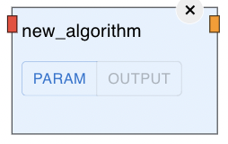
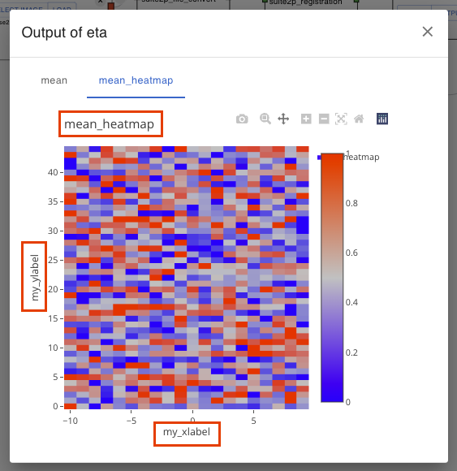
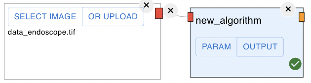
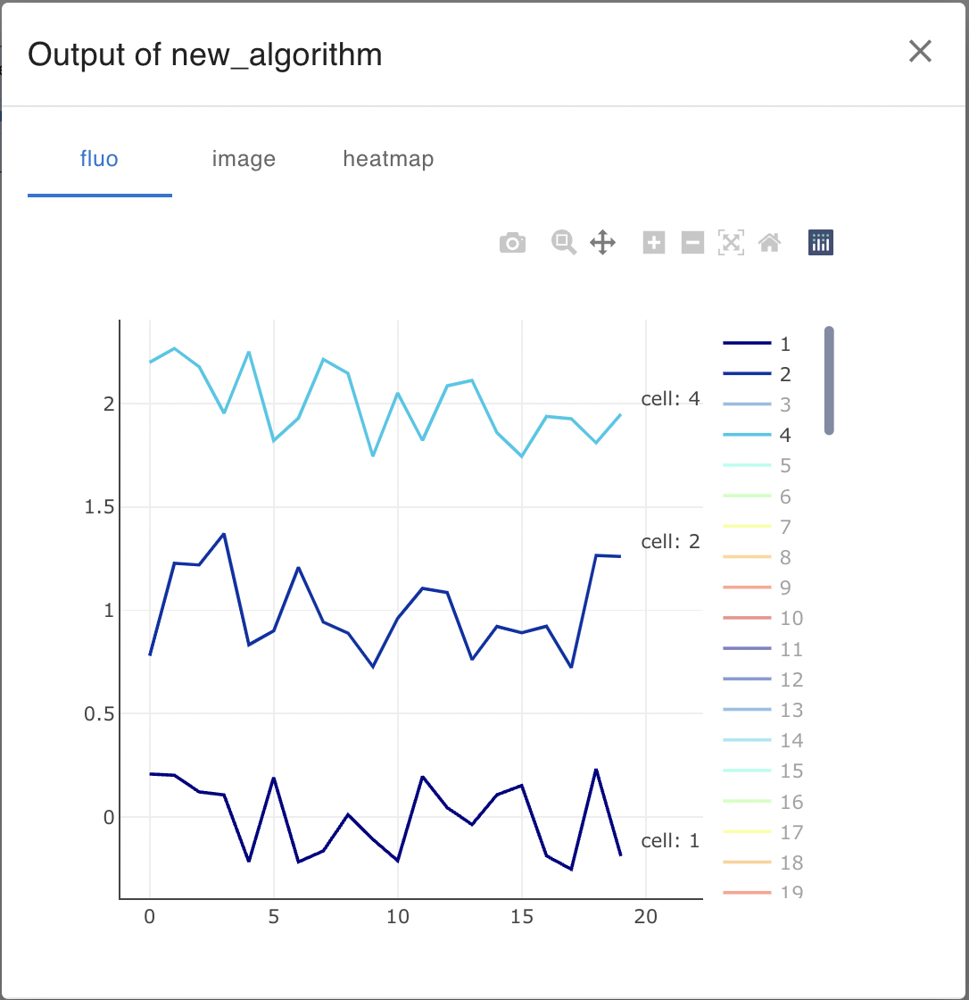

(Add-your-algorithm)=
Add your algorithm
=================

```{contents}
:depth: 3
```

## Example of Algorithm Addition Procedure

### 1. Prepare Necessary Directories and Files for the Algorithm

First, prepare the necessary directories and files for the algorithm.

- Sample Algorithm Function Name ... `my_function`
- {OPTINIST_SRC_DIR} ... Replace with your actual source storage directory path.

- {OPTINIST_SRC_DIR}/studio/app/optinist/wrappers/

  - \_\_init\_\_.py
  - xxxx/
  - yyyy/
  - ...
  - custom
    - \_\_init\_\_.py
    - `custom_node.py` (\*1)
    - ... (\*2)

- Explanation:
  - (\*1) Empty first.
  - (\*2) Prepare other files to be added.

### 2. Algorithm implementation

#### Import Statement Description

- Target file
  - {OPTINIST_SRC_DIR}/studio/app/optinist/wrappers/custom/`my_function`.py

```python
from studio.app.common.dataclass import *
```

- Explanation:

  - If the required data class does not exist, you can add your own.
  - see. [DataClass](#data-classes)

- Caution:
  - Error might show because data class is not specifieid. Please fix it with correct data class you are using.

#### Define the Input/Output of the Function and Implement the Logic.

- Target file

  - {OPTINIST_SRC_DIR}/studio/app/optinist/wrappers/custom/`custom_node`.py

- In the following example, the **my_function** function takes **ImageData** and returns [**FluoData**, **ImageData**, **HeatMapData**].
- The output of the function is a dictionary. (Here we use the variable **info**.)

```python
  import numpy as np
  from studio.app.common.dataclass import HeatMapData, ImageData  # Import general data classes
  from studio.app.optinist.dataclass import FluoData              # Import ROI data classes

def my_function(                                                                 # (*1)
        image_data: ImageData,                                                   # (*2)
        output_dir: str,                                                         # (*3)
        params: dict=None,                                                       # (*4)
        **kwargs,                                                                # (*3)
    ) -> dict(                                                                   # (*5)
      fluo=FluoData,                                                             # (*6)
      image=ImageData,
      heatmap=HeatMapData):

    info = { # Setting some random output data as example
        "fluo": FluoData(np.random.rand(100, 20), file_name="fluo"),             # (*7)
        "image": ImageData(np.random.rand(10, 512, 512), file_name="image"),
        "heatmap": HeatMapData(example_analysis, file_name="heatmap")
    }
    return info
```

- Explanation:
  - (\*1) Function name can be any content.
  - (\*2) The first argument specifies the input data type. (This is also reflected in the GUI.)
  - (\*3) Add these arguments. These arguments are required for the handling workflow.
  - (\*4) This argument receives the function parameters.
    - see. [Function Parameter Definitions](#function-parameter-definitions)
  - (\*5) The return value is a dictionary type. (This is also reflected in the GUI.)
  - (\*6) The fluorescence (**fluo**), imaging frames (**image**) and heatmap data returned.
  - (\*7) The output data by wrapped by the class (e.g. **FluoData**). The name of the output keys in the return variable must match the names used when declaring the function (here **fluo**, **image** & **heatmap**).

### Definition of Information to be Displayed in the GUI

- Target file
  - {OPTINIST_SRC_DIR}/studio/app/optinist/wrappers/custom/\_\_init\_\_.py

```python
from studio.app.optinist.wrappers.custom.custom_node import my_function

custom_wrapper_dict = {                       # (*1)
    'custom_node': {                          # (*2)
        'template': {                         # (*3)
            'function': my_function,          # (*4)
            'conda_name': 'custom',       # (*5)
        },
    }
}
```

- Explanation:
  - (\*1) The variable name is arbitrary, but `{algorithm_name}_wrapper_dict` is the standard.
  - (\*2) Algorithm folder name can be any text (display label to GUI)
  - (\*3) Algorithm node name can be any text (display label to GUI)
  - (\*4) Algorithm function name specifies the python function name
  - (\*5) The conda setting is optional, to be defined when using conda with snakemake (see example below)

After the registration process up to this point, restart the application browser or click the refresh button beside the Nodes menu to confirm that the algorithm has been added.

<p align="left">
  
</p>


### Definition of conda environment for the function

If your function requires specific packages, you can set them using a conda env for your custom node. If nothing is set, a default optinist conda env will be used. See /studio/app/optinist/wrappers/optinist/conda/optinist.yaml for specifics of the default conda env.

- Target file
  - {OPTINIST_SRC_DIR}/studio/app/optinist/wrappers/custom/conda/`custom`.yaml

```yaml
dependencies:
  - python=3.9 # Add the dependencies needed for you function
  - numpy<2 # Exclude numpy 2.x versions
```

- Note:
  - Currently, Optinist packages supports NumPy versions below 2. Please ensure that your Conda environment is configured with an appropriate version of NumPy.
  - If you plan to use NumPy 2.x or higher, ensure all other packages in your environment are compatible with it.

### Check your custom node inputs and outputs

Restart the Application and drag your new **custom_node** on the GUI, hover over the inputs and outputs to see the types.



## Detailed Specifications

### Data classes

Optinist defines several [DataClasses](../specifications/data_nodes.md) to ensure consistency between Input and Output types. These correspond to the color of each Node's handle. The main data input types are as follows.

- OptiNiSt supports these input data classes:

  - ImageData
  - FluoData
  - BehaviorData
  - TimeSeriesData
  - Suite2pData
  - CaimanCnmfData
  - LccdData
  - IscellData
  - NWBFile
  - RoiData
  - SpikingActivityData,


- OptiNiSt supports these data visualisation classes:
  - BarData
  - HeatMapData,
  - HistogramData
  - ScatterData
  - LineData
  - PieData
  - PolarData
  - ScatterData

### Function Parameter Definitions

Default function parameters can be defined in the following file. The user can then update these in the GUI.

- {OPTINIST_SRC_DIR}/studio/app/optinist/wrappers/`custom`/params/{algorithm_function_name}.yaml

- Sample:

  ```yaml
  window_size: 10
  custom_params_nested:
    threshold: 0.5
  ```

- Explanation:
  - {algorithm_function_name} must match the actual function name.

### NWB saving format

Optinist uses NWB format for saving data, analysis and plots. Here are some examples of NWB saving formats.
Check the [NWB](../for_developers/nwb_file.md) for more information of NWB saving format.

In order to repeatedly use nodes and save outputs into distinct files each time, it is necessary to give NWB files unique IDs.
Use the OptiNiSt function ExptOutputPathIds to conveniently make these unique IDs.

```python
def my_function(                     # Required inputs
neural_data: ImageData,              # Fluorescence data from previous processing
output_dir: str,                     # Directory to save output files
# Optional inputs
# iscell: IscellData = None,         # Cell classification data if needed
params: dict = None,                 # Additional parameters to customize processing
\*\*kwargs                           # Catch-all for additional arguments
# Function returns a dictionary containing all outputs
) -> dict(fluo=FluoData, image=ImageData, heatmap=HeatMapData):

      # Setup unique ID (function_id) for saving
      function_id = ExptOutputPathIds(output_dir).function_id

      # Saving using NWB file structure
      # Create a new NWB file dictionary or update existing one
      nwb_output = {}

      # Example of adding processing results
      # Add ROIs if your analysis creates them
      nwb_output[NWBDATASET.ROI] = {function_id, roi_list}  # List of ROI dictionaries

      # Example of adding processing results
      nwb_output[NWBDATASET.POSTPROCESS] = {
          function_id: {
              "data": example_analysis[0]  # Your analysis outputs
          }
      }

      # Example of data in column format (e.g. for classifications)
      nwb_output[NWBDATASET.COLUMN] = {
          function_id: {
              "name": "my_classification",
              "description": "Description of the classification",
              "data": example_analysis[1],
          }
      }

      return info
```

### Customize Plot Metadata

You can set plot title and axis labels to some outputs.



To do this:

1. import PlotMetaData in the algorithm function file.
2. Add PlotMetaData to the output data class's `meta` attribute with title or labels you want. If you need only one of them, you can omit the other attributes.

## Complete custom node example

```{eval-rst}
.. note::
   For development and debugging we have included a set of ipython notebooks
   The function below is reproduced in `notebooks/custom_node.ipynb` and can be run for testing and debugging your node. Once you are happy with the output, please use the above method to add your node to OptiNiSt.
```

```python
import numpy as np
from studio.app.common.schemas.outputs import PlotMetaData
from studio.app.common.dataclass import HeatMapData, ImageData
from studio.app.optinist.dataclass import FluoData

def my_function( # Required inputs
neural_data: ImageData, # Fluorescence data from previous processing
output_dir: str, # Directory to save output files # Optional inputs # iscell: IscellData = None, # Cell classification data if needed
params: dict = None, # Additional parameters to customize processing
\*\*kwargs # Catch-all for additional arguments # Function returns a dictionary containing all outputs
) -> dict(fluo=FluoData, image=ImageData, heatmap=HeatMapData):

      """Example template for creating analysis functions.

      This function shows the basic structure for creating analysis functions
      that work with the pipeline, including proper input handling, NWB file
      creation, and return format.

      Args:
          neural_data: Fluorescence data from previous processing steps
          output_dir: Directory where output files should be saved
          iscell: Optional cell classification data
          params: Optional dictionary of parameters to customize processing
          **kwargs: Additional keyword arguments

      Returns:
          dict: Dictionary containing all output data and metadata
      """

      # 1. Set up logging if needed
      logger.info("Starting my_analysis_function")

      # 2. Get additional data from kwargs if needed
      # nwbfile = kwargs.get("nwbfile", {})

      # 3. Set default parameters and update with user params
      default_params = {"window_size": 10, "threshold": 0.5}
      if params is not None:
          default_params.update(params)

      # 4. Main analysis code goes here
      example_fluo_data = np.random.rand(100, 20)  # Example data

      example_imaging_data = np.random.rand(10, 512, 512)

      example_processing = example_fluo_data > default_params["threshold"]

      example_analysis = np.corrcoef(example_processing)
      for i in range(example_analysis.shape[0]):
          example_analysis[i, i] = np.nan

      # 5. Prepare NWB file structure
      # Create a new NWB file dictionary or update existing one
      nwb_output = {}

      # Add ROIs if your analysis creates them
      nwb_output[NWBDATASET.ROI] = {function_id, roi_list}  # List of ROI dictionaries

      # Example of adding processing results
      nwb_output[NWBDATASET.POSTPROCESS] = {
          function_id: {  # For testing you can also use a string as the key
              "data": example_analysis[0]  # Your analysis outputs
          }
      }

      # Example of data in column format (e.g. for classifications)
      nwb_output[NWBDATASET.COLUMN] = {
          function_id: {
              "name": "my_classification",
              "description": "Description of the classification",
              "data": example_analysis[1],
          }
      }

      # 6. Prepare return dictionary
      # This should contain all outputs and processed data
      info = {
          "fluo": FluoData(example_fluo_data, file_name="fluo"),
          "image": ImageData(example_imaging_data, file_name="image"),
          "heatmap": HeatMapData(example_analysis, file_name="heatmap"),
      }

      return info

```

```{eval-rst}
.. note::
    Following data classes are not supported to visualize metadata.

    - CsvData
    - HTMLData
```

### Using your custom node

Restart the Application, connect imageNode and run it, and you will see the output as follows.

- Note:
  - This is a quick process (only a few seconds), so if the process does not terminate, an error may have occurred. If the error persists, please submit a question as an issue on Github.





## Create New Setup Conda (if Needed)

This guide walks you through creating a new Conda setup script and registering it.

---

### 1. Create `setup_conda_{name}.py`

Create a new Python file named `setup_conda_{name}.py`. Replace `{name}` with your desired identifier.

Paste the following code into the file:

```python
from studio.app.common.core.logger import AppLogger
from studio.app.common.dataclass import ImageData

logger = AppLogger.get_logger()


def setup_conda_custom(
    image: ImageData, output_dir: str, params: dict = None, **kwargs
) -> dict:
    """
    This is a mock wrapper function used to signal Snakemake to create a Conda environment.
    No actual processing occurs in this function.
    """

    logger.info("Conda environment setup complete.")

    # Dummy return data
    return {"image": image}
```

> **Note:** This function doesn't perform any real processing. It simply acts as a placeholder to trigger Conda environment creation through Snakemake.

### 2. Register the New Setup Conda in `__init__.py`

Open the `__init__.py` file where setup functions are registered.

Add the new entry in the format below:

```python
"setup_conda_custom": {
    "function": setup_conda_custom,
    "conda_name": "custom",  # Set this to the name of the Conda environment you want
},
```

> **Tip:** Make sure that the `conda_name` matches the environment you’ve defined in your Snakemake workflow.

### 3. Add the Sample Workflow

When a node's Conda environment is missing, its **Create env** dialog imports and runs the sample workflow `setup_conda_{name}` from `sample_data/maintenance/output/`. Without it, the dialog fails.

Copy an existing directory (e.g. `setup_conda_lccd/`) to `setup_conda_{name}/`. In all three files (`experiment.yaml`, `workflow.yaml` and `snakemake.yaml`):

1. Replace the algorithm node id (e.g. `setup_conda_lccd_3suw9pfbqj`) with `setup_conda_{name}_` plus a new random suffix (e.g. `setup_conda_{name}_a1b2c3d4e5`). Replace every occurrence: the id also appears in the edge key, `id`, `target` and `targetHandle` in `workflow.yaml`.
2. Then replace the remaining `setup_conda_lccd` with `setup_conda_{name}`.

---

You're all set! Your custom Conda setup function is now ready to be used with Snakemake.
